# Full-Stack Engineer. Laravel and MERN. System design first.

I design and build complete web platforms, from the domain model to a tested system running live.

I work in two stacks and I am equally strong in both. Laravel with Livewire, Filament or React through Inertia. MERN with Next.js, Express, MongoDB and TypeScript. I pick the stack that fits the product, not the other way round.

Three platforms so far, all designed, built and shipped by me: a live hiring platform with 1,590 tests, a 7-role restaurant platform with 2,508 tests, and a MERN events platform with a JWT-secured API.

## How I build

1. **Users and roles first.** Who uses the system and what each role is allowed to do.
2. **Domain model and ERD.** The data and its rules are designed before any screen.
3. **Decisions written down.** Every big choice gets an ADR, so the reason survives the code.
4. **Layered delivery.** One layer per pull request, each one complete and working on its own.
5. **Rules in one place.** One action class per business rule, one policy for every permission.
6. **Tests and CI on every push.** Pest, PHPStan, query-count guards against N+1, GitHub Actions.

## Main projects

**[HearBack](https://github.com/Md-Foisal/job-board)**, hiring platform (Laravel). [Live at hearbackjobs.com](https://hearbackjobs.com)

> 35 models, 40 domain actions, 19 policies and 9 ADRs, delivered in 9 layers with 1,590 tests in CI.

Candidates, employers and staff in one system: jobs, applications with a timeline, an applicant board, moderation, company reviews, and a CV builder with 7 templates and Chromium PDFs. In production with Docker, MySQL, Google and GitHub login, two-factor login, S3-compatible uploads and real mail. Built with Laravel 13, PHP 8.4, Livewire, Filament, Fortify and Pest.

**[Tandoor House](https://github.com/Md-Foisal/tandoor-house)**, restaurant platform (Laravel and React). [Demo](https://tandoor-house.onrender.com) and [film](https://youtu.be/NwxVs3GprHQ)

> 7 roles in one real-time platform, 2,508 Pest tests, PHPStan level 7, WCAG 2.2 AA checked with axe.

Online ordering for delivery, pickup and dine-in with a QR code on each table, table booking with deposits, a cashier screen, a live kitchen display, a waiter floor plan, rider runs, manager stock and rota, and owner reports. Built with Laravel 13, React 19, Inertia, strict TypeScript, Tailwind CSS, Reverb and Stripe in test mode, from a brief for a fictional restaurant. The demo runs on a free server, so the first load can take a minute.

**[Kindred](https://github.com/Md-Foisal/kindred-client)**, community events platform (MERN). [Live](https://kindred-events.vercel.app) and [film](https://youtu.be/gdyQ4FAR8_4)

> The Express API checks Better Auth JWTs against the client's public keys, so no secret is shared between the two apps.

Create, join, leave and manage social service events, with email, Google and GitHub login, image upload, search, a type filter and dark mode. A Next.js and TypeScript client with a separate [Express, TypeScript and MongoDB REST API](https://github.com/Md-Foisal/kindred-server).

## Other projects

- **[BazarDor](https://github.com/Md-Foisal/bazardor)**: daily market prices across Bangladesh, with Google and GitHub login. Next.js, TypeScript, MongoDB and Better Auth. [Live](https://bazardor-foisal.vercel.app)
- **[LiftLedger](https://github.com/Md-Foisal/liftledger)**: workout planner with a daily plan, saved lifts and live stats. Next.js, TypeScript and daisyUI. [Live](https://liftledger-app.vercel.app)
- **[Dev Stack](https://github.com/Md-Foisal/stackforge)**: browse developer tools and build your own stack. React and daisyUI. [Live](https://stackforge-foisal.vercel.app)
- **[Blog Platform](https://github.com/Md-Foisal/blog-management-system)**: Laravel REST API with Sanctum, and a Vue 3 and Pinia front end.
- **[Product Manager](https://github.com/Md-Foisal/product-management-system)**: Laravel CRUD with search, sorting and pagination.

## Now

Intern at [Indiv Digital](https://indivdigital.com) in Dhaka, where I design AI-driven production systems. The biggest one is an AI software factory: one request, for example "an ERP for a business", becomes a researched feature table for approval, and then a parallel build by 17 Claude Code agents in 5 teams (product, design, architecture, development and quality), with approval gates and memory between sessions.

First in my Ostad full stack batch, with 99.7% in quizzes and 100% in assignments, live tests and coding tests.

## Stack

**Laravel.** PHP 8.4 and Laravel 13 with Eloquent, Livewire, Filament, Inertia, Fortify, Sanctum, Reverb, queues and policies, on MySQL, tested with Pest and PHPStan.

**MERN.** MongoDB, Express, React 19 and Node.js, with Next.js on the App Router, TypeScript, Better Auth and JWT, and clean REST API design.

**Cloud and AI.** Docker, Render, Vercel, S3-compatible storage, Cloudflare Workers, Resend and Stripe, with CI on GitHub Actions. AI features with the Anthropic API, and multi-agent build systems with Claude Code.

## Contact

Open to remote work, on-site work in Dhaka, and moving abroad with visa sponsorship.

Email me at <a href="mailto:mffoisal8@gmail.com">mffoisal8@gmail.com</a> or find me on <a href="https://www.linkedin.com/in/md-foisal-395848142">LinkedIn</a>.
